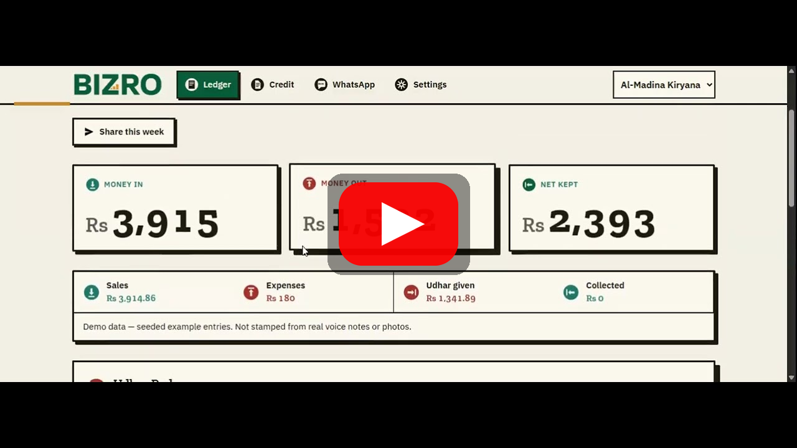
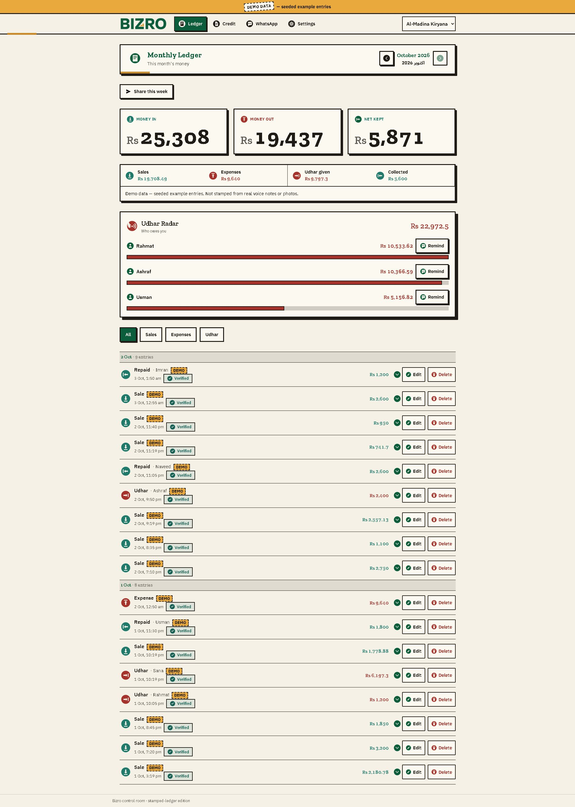
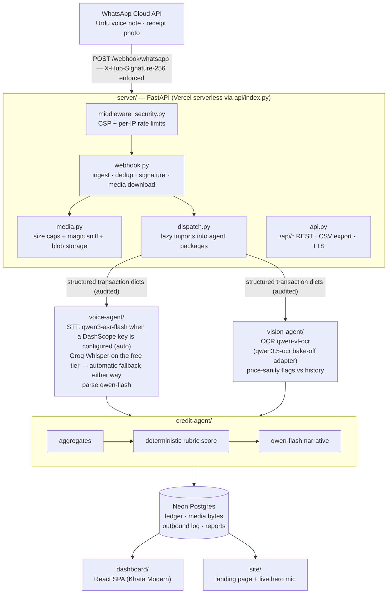

# Bizro

### Project walkthrough

<p align="center">
  <a href="https://youtu.be/epfOT6UnsNU">
    
  </a>
</p>

Bizro is a zero-typing WhatsApp bookkeeping copilot for Pakistani karyana
(corner) shopkeepers. A shopkeeper sends an Urdu voice note ("sold ghee to
Rahmat for 3000 cash") or a receipt photo on WhatsApp; the pipeline parses it
into a structured ledger entry with a full audit trail (the original
audio/photo bytes are stored), and the accumulated history produces a
lender-legible Credit Readiness report for Alkhidmat Mawakhat loan officers.

No app to install, nothing to type. The khata becomes a memory, and the memory
becomes credit.

Built for the Bano Qabil x Alibaba Cloud AI Hackathon Pakistan 2026.

## The product in seconds

<p align="center">
  <video src="assets/bizro-ad.mp4" controls muted playsinline width="720"></video>
</p>

A 43-second ad for the zero-typing loop: an Urdu voice note or receipt photo
in on WhatsApp, a structured ledger entry and a credit-ready history out.

<p align="center">
  
</p>

The merchant ledger as deployed: sales, expenses, udhar given and collected,
per-customer receivables, one-tap edit/delete, and an honest demo-data banner
on seeded examples.

## Live

- Production: <https://bizro-pk.vercel.app> — `/`, `/ledger` and `/health` all
  returned HTTP 200 on 2026-09-07
- Aliases: `getbizro.vercel.app`, `bizro-app.vercel.app`, `bizro-ai.vercel.app`
- `/` is the marketing site. The dashboard SPA lives at `/ledger`, `/credit`,
  `/simulator`, and `/settings`; any other path gets an honest not-found screen.
- Live status (`GET /health`): DashScope live on the international Model Studio
  endpoint, WhatsApp live with webhook signature validation enforced, all four
  agent pipelines imported.

## Architecture

One repo, one origin. A FastAPI app serves the WhatsApp webhook, the REST API,
and the built frontend assets; the model work lives in three agent packages
the server calls into.



Model calls run on Alibaba Cloud Model Studio (DashScope
OpenAI-compatible mode) by default. Speech-to-text is qwen3-asr-flash when a
DashScope key is configured (automatic); on the free tier Groq
whisper-large-v3-turbo does the transcribing, and any Qwen failure falls back
to it automatically — a voice note is never lost to one transcriber's hiccup.
The chat endpoint can also point at any OpenAI-compatible host (`.env.example`
ships a budget-capped OpenRouter free-tier swap). See `docs/Bizro_Guide.pdf`
for the full pipeline walkthrough, the model stack and its fallbacks, and the
security posture.

## Repo layout

- `server/` — FastAPI app: webhook, REST API, media audit trail, security
  middleware (`server/app/`). Vercel entry: `api/index.py`.
- `dashboard/` — React + Vite + Tailwind control room ("Khata Modern"):
  ledger, credit, simulator, settings screens.
- `site/` — the marketing landing page, including a hero demo card that
  records real browser audio and posts it to the live webhook.
- `voice-agent/` — voice pipeline: STT plus transaction parsing.
- `vision-agent/` — receipt OCR pipeline with price-sanity flags.
- `credit-agent/` — Credit Readiness report: aggregates, rubric, narrative.
- `qa/` — read-only QA suite: contract tests against the shared schema and
  dashboard contract tests.
- `docs/` — the shipped documentation: `Bizro_Guide.pdf` (deep guide) and
  `Bizro_Pitch.pptx` (pitch deck).
- `scripts/` — `deploy.sh` (prod deploy) and `run_demo.sh` (one-command local
  demo).
- `.agents/` — the multi-agent build system used during the hackathon
  (orchestrator dispatches worker skills). Local-only and gitignored: the
  shipped repo is the product, not the scaffolding.

## Quickstart

Prerequisites: Python 3.12+, Node 18+ (for the frontends), a terminal (Git
Bash on Windows works; commands below are run from the repo root).

One command (creates a venv, installs, builds the UIs, seeds demo data,
serves everything on `http://localhost:8000`):

```bash
bash scripts/run_demo.sh
```

Or step by step:

```bash
# 1. Python environment + dependencies
python -m venv .venv
source .venv/Scripts/activate    # Git Bash on Windows (bin/activate elsewhere)
python -m pip install -r requirements.txt

# 2. Environment: copy the contract and fill in what you have
cp .env.example .env
# Zero keys is a valid state: MOCK_MODE=auto serves clearly-labeled mock
# output everywhere, and the offline test suites need no credentials.

# 3. Seed demo data (only if the DB is empty), then run the server
python credit-agent/scripts/seed_demo.py
python -m uvicorn server.app.main:app --reload --port 8000

# 4. Frontends (second terminal each)
cd dashboard && npm install && npm run dev   # http://localhost:5173, proxies /api and /webhook to :8000
cd site && npm install && npm run dev        # landing page dev server
```

With the server alone (no Node), the built `site/dist` and `dashboard/dist`
are served at `/` and `/ledger` directly — that is exactly what production
does.

## Tests

All suites are offline and deterministic; no credentials needed.

```bash
cd server && python -m pytest tests -q        # 129 passed (measured 2026-09-04)
cd site && npx vitest run                     # 30 passed, 4 files
python -m pytest qa/tests voice-agent/tests vision-agent/tests credit-agent/tests -q   # 191 passed, 3 xfailed, 13 xpassed
```

350 tests green in total. Type checks: `npx tsc --noEmit` in `dashboard/` and
`site/` (also enforced by `npm run build`).

## Deploy

```bash
npx vercel login        # once
bash scripts/deploy.sh
```

The script builds `dashboard/` and `site/`, runs `vercel deploy --prod`,
re-points the four aliases, and verifies `/health` and `/` return 200. Vercel
env vars (see the table below) are managed in the Vercel dashboard. Production
runs on Neon Postgres with `MEDIA_DIR=/tmp/media` — see `docs/Bizro_Guide.pdf`
for what is durable where. One durability caveat: `/tmp` is ephemeral across
serverless deployments, so the audit-trail media bytes need the database
backend (`MEDIA_BACKEND=db`) to be durable there — see
[Limitations & roadmap](#limitations--roadmap).

## Environment variables

Canonical contract: `.env.example` (copy to `.env`). Never commit `.env`.

| Variable | Purpose | Default |
| --- | --- | --- |
| `DASHSCOPE_API_KEY` | Alibaba Model Studio key; empty switches all model output to clearly-labeled mock | — |
| `DASHSCOPE_BASE_URL` | OpenAI-compatible endpoint (international accounts: `https://dashscope-intl.aliyuncs.com/compatible-mode/v1`) | China-mainland URL |
| `MODEL_VOICE` | Voice/text transaction parsing model | `qwen-flash` |
| `MODEL_OCR_VL` | Primary receipt OCR model | `qwen-vl-ocr` |
| `MODEL_OCR_NEW` | Bake-off OCR adapter model | `qwen3.5-ocr` |
| `MODEL_REASONING` | Credit narrative + reminder drafts | `qwen-flash` |
| `OCR_MODEL` | Which OCR adapter runs: `vl` or `new` | `vl` |
| `STT_PROVIDER` | `qwen` → qwen3-asr-flash primary when a DashScope key is configured (any failure auto-falls-back to Groq); `groq` → Whisper free tier | `groq` |
| `STT_QWEN_MODEL` | Qwen ASR model id | `qwen3-asr-flash` |
| `STT_API_KEY` / `STT_BASE_URL` / `STT_MODEL` / `STT_LANGUAGE` | Groq Whisper fallback (free tier) | Groq URL, `whisper-large-v3-turbo`, `ur` |
| `WHATSAPP_TOKEN` / `WHATSAPP_PHONE_NUMBER_ID` | WhatsApp Cloud API credentials (System User token) | — |
| `WHATSAPP_VERIFY_TOKEN` | Webhook verification handshake | `bizro-verify` |
| `WHATSAPP_APP_SECRET` | Enables `X-Hub-Signature-256` enforcement; empty = disabled | — |
| `DATABASE_URL` | SQLite locally; Neon Postgres in production | `sqlite:///./bizro.db` |
| `MEDIA_DIR` | Media tree root (`/tmp/media` on Vercel) | `./media` |
| `MOCK_MODE` | `auto` (real when keys exist), `always`, `never` | `auto` |
| `CONFIDENCE_CONFIRM_THRESHOLD` | Parse confidence below this keeps entries pending | `0.75` |
| `NUMERAL_STYLE` | `western` or `urdu` digits in surfaces | `western` |
| `PORT` | Server port | `8000` |
| `RATE_LIMIT_WEBHOOK_PER_HOUR` | Per-IP hourly budget for `POST /webhook/whatsapp` | `30` |
| `RATE_LIMIT_GENERAL_PER_MIN` | Per-IP per-minute budget for everything else | `120` |
| `OPENROUTER_DAILY_BUDGET` | Hard stop for `llm_guard.py` when the endpoint points at OpenRouter | `40` |

Defaults above are the code defaults (`server/app/config.py`,
`voice-agent/voice_agent/config.py`, `vision-agent/vision_agent/config.py`);
`.env.example` mirrors them, including the `qwen3-asr-flash` STT block and a
commented OpenRouter free-tier fallback (OpenAI-compatible swap for the
`DASHSCOPE_*` names, budget-capped by `llm_guard.py`).

## Documentation

Both deliverables live in `docs/`:

- `docs/Bizro_Guide.pdf` — the deep guide as a print-ready PDF: local setup,
  the webhook flow, the Qwen model stack and fallbacks, the demo walkthrough,
  security posture, ops, and troubleshooting.
- `docs/Bizro_Pitch.pptx` — the 11-slide pitch deck (problem, the Mawakhat
  lending rail, solution, live demo, how it works, technology, trust & audit,
  why Bizro, impact).
- `docs/privacy-notes.md` — plain-language data notes: what Bizro stores, why,
  for how long, who can see it, and how deletion works.

## Trust model

Bizro never claims a ledger entry is *true*. It records where every entry
came from and how confident the model was, then makes corroboration visible:

- **Every entry stores source + confidence** — source type (voice / photo /
  text), the model that parsed it, a link to the original audio/photo bytes
  (sha256-hashed on ingest), the raw model output, and a 0–1 parse
  confidence. Nothing is summarized away.
- **Trust tiers** — entries carry `self_reported` / `customer_confirmed` /
  `third_party` provenance as they move up from the merchant's word alone
  (entry contract, `server/schema.md`).
- **Reports headline the corroborated-revenue percentage** — how much of the
  stated revenue stands on more than self-report.
- **Ledger integrity chain + verification endpoint** (schema.md §11) —
  ledger rows are hash-chained so tampering is detectable, with an endpoint
  that re-verifies the chain.
- **Data-quality indicators, not a trust score** — backfill lag, burst
  inserts, stock coherence, window spikes and provenance mix are computed in
  `credit-agent/credit_agent/data_quality.py` and disclosed to the loan
  officer as evidence for *their* judgment. The code says it outright: these
  are disclosure, never an accusation, never a black-box number.
- **Supplier verification** — receipts that carry a supplier phone can
  trigger a yes/no WhatsApp confirmation to the distributor
  (`POST /transactions/{id}/verify-supplier`); the request lands on the audit
  trail today, automatic reply-matching is future scope (below).

## What it costs per shop

A ballpark estimate, clearly not a quote — prices checked Oct 2026 and they
drift; the authoritative table is Alibaba Cloud Model Studio pricing.

Per event (rough):

| Event | Model calls | Est. cost |
| --- | --- | --- |
| Urdu voice note (~15 s) | qwen3-asr-flash ASR + qwen-flash parse + confirmation reply | ~ $0.001–0.002 |
| Receipt photo | qwen-vl-ocr OCR + price-sanity parse | ~ $0.001–0.002 |
| Credit Readiness report | deterministic aggregates + one qwen-flash narrative | ~ $0.005 |

Per shop per month (30 days, at $0.0015 per note/receipt midpoint):

| Shop profile | Volume | Est. monthly model cost |
| --- | --- | --- |
| Light | 5 voice notes + 2 receipts/day | < $1 |
| Medium | 15 voice notes + 5 receipts/day | ~ $1 |
| Heavy | 40 voice notes + 10 receipts/day | ~ $2–3 |

Assumptions: qwen-flash ≈ $0.10/M input and $0.40/M output tokens with a
parse call ≈ 1K in + 0.3K out; qwen3-asr-flash ≈ $0.000035/s of audio;
WhatsApp service-dialogue replies (inside the user-initiated 24 h window)
are currently free on Meta's Cloud API; hosting on free tiers (Vercel, Neon)
adds $0 at demo scale. Even a heavy shop is single-digit dollars a month.

**Who pays: the lending institution or donor that runs the deployment. The
merchant pays nothing — zero-typing also means zero-billing.**

## Privacy

Plain-language notes: `docs/privacy-notes.md`. Formal policy:
`PRIVACY_POLICY.md` (English + Urdu summary). The short version:

- **Consent** — the merchant opts in by messaging the Bizro number; every
  entry exists because the merchant sent it.
- **What's stored** — the original voice-note and receipt-photo bytes (audit
  trail), transcripts, the extracted fields, and customer names as the
  merchant speaks them. Customer phone numbers are stored only when provided,
  and customers are identifiable in udhar entries — see the notes doc for why
  customers should be told.
- **Retention** — recommended: purge audio/photo bytes after 24 months; the
  ledger rows are the merchant's books and stay until deleted.
- **Deletion** — "data delete" in the Bizro chat (or email) removes the
  merchant's account and records within 30 days.
- **Who can see it** — the merchant, and, when the merchant shares a report,
  the lending institution's loan officer.

## Limitations & roadmap

Bizro is honest about what it cannot know. The gaps, named first:

- **Every entry is merchant-volunteered.** Self-reported by default —
  omission is invisible. Trust tiers and supplier verification exist to raise
  corroboration, not to prove truth; the credit-agent code explicitly refuses
  to be a "lie detector".
- **The readiness score is a readiness indicator, not a validated repayment
  predictor.** No loan-outcome data exists yet, so the rubric has never been
  calibrated against who actually repaid.
- **Anti-fabrication checks are heuristics, not validated forensics.**
  Backfill / stock-coherence / spike detection catch arithmetic
  inconsistencies and patterns; they are disclosure for an officer, not proof
  of fraud.
- **Urdu-first.** Punjabi and Pashto — first languages for many karyana
  shopkeepers — are not yet covered end-to-end.
- **Supplier verification is half-built.** The request is sent and logged on
  the audit trail; matching the distributor's reply is future scope.
- **Serverless media is ephemeral without `MEDIA_BACKEND=db`.** On Vercel the
  filesystem is `/tmp`, so audit-trail bytes only survive deployments once
  media lives in the database (the `media_blobs.data` column already exists).

| Gap | Concrete next step |
| --- | --- |
| Self-reported entries | Roll out the customer-confirmation and supplier-verification loops so the corroborated share of each ledger grows; tier-gate what reports may claim |
| Unvalidated score | Collect anonymized repayment outcomes from Mawakhat officers, refit the rubric weights against realized outcomes, publish the calibration |
| Heuristic checks | Label real backfill/anomaly cases with loan officers; tune the thresholds against ground truth instead of priors |
| Urdu-only | Evaluate Punjabi/Pashto ASR quality, add language detection and per-language parse prompts and confirmation copy |
| Reply matching | Parse the yes/no WhatsApp reply to close the verify-supplier handshake and flip the entry's trust tier |
| Ephemeral serverless media | Implement the `MEDIA_BACKEND=db` path (bytes into `media_blobs.data`) and make it the default on Vercel |
